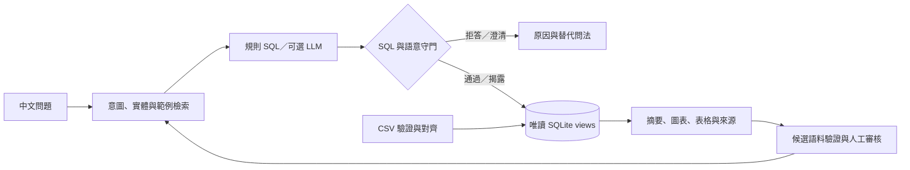

# PowerQuery TW｜台電開放資料 Text2SQL 智慧查詢系統

用中文查詢台電資料，並在回答前確認 SQL 安全性與資料是否足以支持答案。

目前已實作至 **Phase 9**：SQLite 語意層、離線規則路由、可選 OpenAI adapter、SQL／語意雙守門、離線評測、FastAPI、圖表工作台，以及需登入與人工審核的資料／語料管理。離線模式不需要 API key；它使用確定性規則，未涵蓋的問法會拒答，不是本機生成式模型。

## 快速開始：本機離線展示

需要 Python 3.11 以上與 [uv](https://docs.astral.sh/uv/)。在專案根目錄執行；第一次安裝依賴需要網路，之後的建庫與可信資料查詢使用 repo 內的 CSV，不下載資料、不呼叫模型。

```powershell
uv sync --frozen --extra dev
uv run --no-sync python -m project_tasks init-dirs
uv run --no-sync python -m ingest.build_db
# 預設模式為 auto；移除此程序繼承的 key，確保本次展示使用離線模式。
Remove-Item Env:OPENAI_API_KEY -ErrorAction SilentlyContinue
uv run --no-sync powerquery --serve
```

開啟 <http://127.0.0.1:8000/>。服務視窗按 `Ctrl+C` 停止。macOS／Linux 請將 `Remove-Item` 那行改為 `unset OPENAI_API_KEY`。

Windows 也可雙擊 [`啟動.bat`](啟動.bat)，使用 <http://127.0.0.1:8765/>；啟動器會按需同步 dev／online 依賴、建庫，健康檢查通過後開瀏覽器。它沿用程序環境，有 key 時預設 `auto` 會啟用線上 runtime；要固定離線展示請使用上面的明確步驟。

可直接測試：

```powershell
uv run --no-sync powerquery "2026年6月每日備轉容量率"
uv run --no-sync powerquery --json "天然氣機組共有幾台？"
```

展示快照的預期結果：

| 問題／檢查 | 預期 |
|---|---|
| `GET /api/health` | `success: true`、`mode.active_mode: offline` |
| `GET /api/stats` | 175 台機組、36,928 筆尖峰出力、138 筆歲修紀錄 |
| 2026年6月每日備轉容量率 | 30 筆，折線圖與原始列 |
| 天然氣機組共有幾台？ | 24 台 |
| 2025年1月1日有哪些機組在歲修？ | 成功但 0 筆，沒有圖表；不代表確認當天無歲修 |
| 台中電廠去年總發電量是多少？ | `PEAK_SUM_ACROSS_DAYS`，拒絕將跨日功率加總成電量 |

完整啟動、管理登入、API 請求、缺檔排查與部署邊界見 [docs/SERVING.md](docs/SERVING.md)。

## 已實作能力

| 能力 | 目前行為 |
|---|---|
| 資料工程 | CSV 驗證、機組名稱／容量對齊、長表轉換、SQLite 星狀模型與中文 `v_*` views |
| 查詢 | 中文意圖／實體抽取、規則路由、TF-IDF 範例檢索；可選線上 LLM 與受限重試 |
| 安全守門 | SQL AST、唯讀與 view／欄位允許清單、筆數／逾時限制 |
| 語意守門 | 針對指標、單位、時間、粒度與涵蓋範圍進行拒答、澄清或限制揭露 |
| 呈現 | SQL、參數、執行 trace、摘要、統計、表格及受限 line／bar／scatter 圖表；CDN 不可用時用本機 SVG |
| 資料治理 | 六個 CSV 資料槽、候選建庫、人工審核、不可變版本、原子切換與雜湊鏈稽核 |
| 語料治理 | 去識別、去重、benchmark 洩漏檢查、重播／回歸驗證；候選均須人工核准後發布 |
| 評測 | 語料內／外題組、結果比對、SQL 攻擊、語意陷阱、誤攔與 ablation 報告 |



網頁包含查詢中心、資料總覽、資料管理、API 與模型、API 文件五個工作區。公開查詢不需登入；資料、語料及模型管理需管理 session，寫入另需同源與 CSRF 驗證。本機預設 `admin`／`PowerQuery@123` 僅用於 loopback demo；自訂帳密與操作方式見 [管理登入](docs/SERVING.md#資料管理登入)。

## 資料快照與涵蓋範圍

repo 隨附 `taipower_align/` 的六個建庫 CSV：`units.csv`、`daily.csv`、`crosswalk.csv`、`daily_long.csv`、`outage.csv` 與 `generation_cost.csv`。建庫會產生本機 `data/processed/power.db`，資料版本、來源 SHA-256、筆數與期間寫入 manifest。

| 展示快照 | 數量／範圍 |
|---|---:|
| 機組主檔 | 175 台 |
| 每日尖峰資料期間 | 2025-01-01 ～ 2026-07-31，577 天 |
| 每日機組／彙總欄位 | 64 個，其中 43 個可對應機組主檔 |
| 尖峰出力長表 | 36,928 筆 |
| 歲修紀錄 | 138 筆，查詢應以實際涵蓋日期為準 |
| 發電成本 | 2023～2025 年按發電方式的元／度資料；保留審定／自編決算口徑 |

**全量原始資料封存未隨 Git checkout 提供。** `manifest.json` 與 `files/` 屬另外準備的快照；未提供時可信資料查詢仍可用，選擇「全量原始資料」則會回報缺少 manifest。原始資料搜尋／預覽不等於通用跨檔 Text2SQL，也不能取代語意層的可答性限制。準備方式見 [原始資料範圍](docs/SERVING.md#可信資料與全量原始資料)。

資料來源包含台電 [機組設備](https://data.gov.tw/dataset/8934)、[過去電力供需](https://data.gov.tw/dataset/19995)、歲修與各種發電方式成本資料。資料使用依政府資料開放授權條款；每日供需來源採滾動視窗，更新時需另行封存，不能把此展示快照視為即時資料。對齊方法見 [taipower_align/README.md](taipower_align/README.md)。

## 驗證與開發

```powershell
uv run --no-sync pytest
uv run --no-sync ruff check .
uv run --no-sync ruff format --check .
uv run --no-sync python -m eval.run_eval
```

離線評測讀取 `benchmarks/`，輸出 `reports/eval_latest.json`、歷史紀錄與 SVG。報告的 `mode` 為 `offline_deterministic_rules`；通過此題組代表目前快照上的離線能力，不代表線上模型或任意中文問題的正確率。benchmark 不得晉升為檢索語料。

OpenAI 線上評測另外使用 `python -m eval.run_online_eval`，預設只做預檢，實際呼叫必須明確指定 `--online` 與 `--model`。設定、呼叫上限與報告判讀見 [線上評測指南](docs/ONLINE_EVALUATION.md)；模型名稱與 API key 尚待提供，因此目前沒有真實模型準確率。此次新增問法、修正前後結果與涵蓋限制見 [查詢品質紀錄](docs/query-quality.md)。

可信資料更新需先將新來源清理、對齊成上述六個 CSV 的格式，再透過網頁「資料管理」建立候選、檢查驗證結果並人工核准，詳見 [資料熱插拔流程](docs/SERVING.md#資料熱插拔資料庫版本與稽核)。單純下載檔案不會更新可信資料庫；原始封存目錄也須使用相容的 manifest，不能以下載器產物直接取代。Windows 手動重建 DB 前請先停止服務，避免 SQLite 檔案鎖定。網頁內經人工審核的資料版本切換則可在服務運行時完成。

```text
src/ingest/       下載、驗證、SQLite builder 與 schema
src/align/        名稱、粒度、歲修與資料陷阱對齊
src/text2sql/     router、entities、retriever、LLM、雙守門與 pipeline
src/serving/      FastAPI、runtime、管理驗證、版本／語料治理與靜態前端
src/eval/         離線評測
corpus/           核准檢索語料
benchmarks/       獨立評測題組
tests/            單元、契約、整合與端到端測試
configs/          路徑、檢索、模型與護欄設定
```

## 已知限制

- 尖峰出力是單一時刻的功率，不能跨日加總成發電量；也不能據此估算個別電廠成本或碳排。年度發電方式成本有獨立資料與會計口徑。
- 每日資料不含逐時／每十分鐘曲線；缺少紀錄或空結果不能推論實際值為零。
- 部分電廠機組位於殘差或跨廠彙總欄位，不能還原完整電廠出力；核能、IPP 等也缺少相同粒度主檔。
- 離線模式的路由範圍有限；線上模式仍受相同 SQL 與語意護欄約束，且需自行配置依賴、模型與 key。
- 主工作台可在無 CDN 時用 SVG；`/docs` 的 Swagger UI 首次載入仍需 jsDelivr。
- 服務預設僅供本機展示。公開 hosting 與 tunnel 均為另行選擇的部署操作，快速開始不會啟動。

## 進一步文件

- [啟動、管理與 API 使用方式](docs/SERVING.md)
- [API 契約](src/serving/API_CONTRACT.md)
- [完整設計規格](docs/superpowers/specs/2026-09-09-text2sql-taipower-design.md)（歷史設計；實際行為以程式與目前使用文件為準）
- [AI Agent 協作與整合規範](docs/AI_AGENT_COLLABORATION.md)
