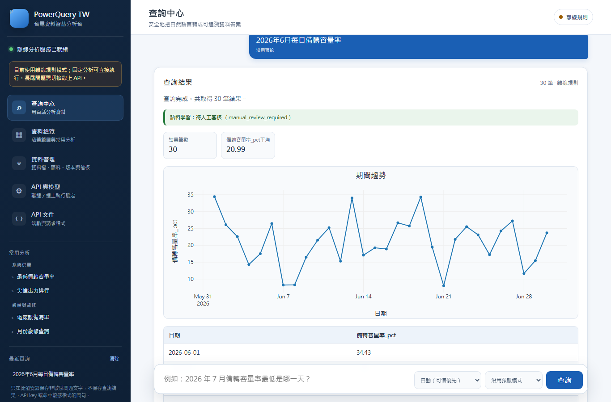
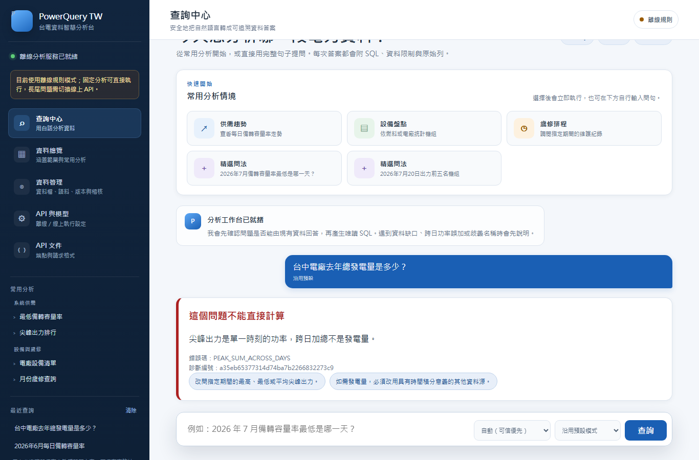
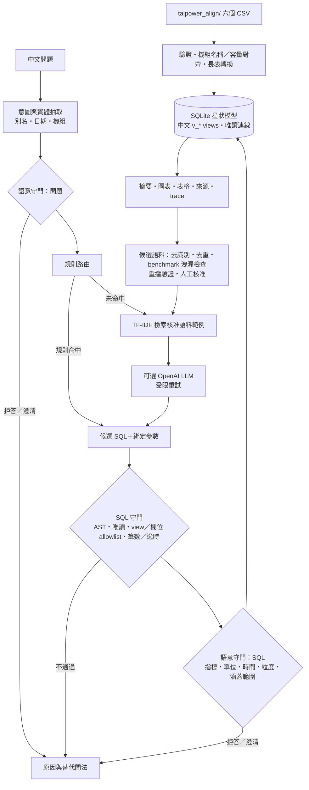

# PowerQuery TW｜台電開放資料 Text2SQL 智慧查詢系統

> 用中文問台電開放資料，系統在回答前先確認 SQL 是否安全、資料是否真的足以支持答案；答不了的問題會明確拒答或要求澄清，而不是硬湊數字。

**這是團隊專案的 fork。** 本 repo fork 自 [lee851104/text2sql_project](https://github.com/lee851104/text2sql_project)（基準為 upstream 2026-09-14 的 `9a8ecad`，之後 upstream 的更新沒有同步到這裡）。系統主體由團隊完成；我負責的範圍列在[我負責的部分](#我負責的部分)。

## 要解決的問題

- **誰**：想查詢台灣電力供需、機組出力、歲修與發電成本的分析人員與一般民眾。
- **痛點**：台電開放資料分散在多個 CSV，欄位命名、機組名稱與時間粒度不一致，查一個問題往往要自己對齊多份檔案再寫 SQL。
- **為什麼難**：
  - 資料陷阱很多：每日資料是**系統尖峰時刻的功率（萬瓩）**，不能跨日加總成發電量（度）；空結果不代表實際值為零；部分機組只存在於彙總欄位。
  - Text2SQL 即使 SQL 語法正確、執行成功，也可能回答了錯誤的問題。因此除了 SQL 安全，還需要「語意層面」的守門。

## Demo





*2026-10-30 以離線規則模式、repo 隨附的資料快照在本機擷取；未呼叫任何模型。*

目前沒有公開部署；離線模式不需要 API key，可在本機直接展示。預期結果（隨附資料快照）：

| 問題／檢查 | 預期 |
|---|---|
| `GET /api/health` | `success: true`、`mode.active_mode: offline` |
| `GET /api/stats` | 175 台機組、36,928 筆尖峰出力、138 筆歲修紀錄 |
| 2026年6月每日備轉容量率 | 30 筆，折線圖與原始列 |
| 天然氣機組共有幾台？ | 24 台 |
| 2025年1月1日有哪些機組在歲修？ | 成功但 0 筆；不代表確認當天無歲修 |
| 台中電廠去年總發電量是多少？ | `PEAK_SUM_ACROSS_DAYS`，拒絕將跨日功率加總成電量 |

網頁包含查詢中心、資料總覽、資料管理、API 與模型、API 文件五個工作區；結果會顯示 SQL、參數、執行 trace、摘要、表格與受限的 line／bar／scatter 圖表。

## 架構



主要模組：`src/text2sql/`（router、entities、retriever、llm、`sql_guard.py`、`semantic_guard.py`、pipeline）、`src/serving/`（FastAPI、runtime、管理驗證、資料／語料治理、靜態前端）、`src/ingest/`、`src/align/`、`src/eval/`。離線模式使用確定性規則，未涵蓋的問法會拒答，不是本機生成式模型。

## 技術重點

以下 1–4 為系統既有設計（團隊完成），5–6 為我在 fork 中的工作。

**1. 雙層守門：SQL 安全 ≠ 答案正確。** `SqlGuard` 以 AST 檢查唯讀、view／欄位 allowlist 與筆數／逾時限制；`SemanticGuard` 再檢查指標、單位、時間、粒度與涵蓋範圍，例如把「跨日尖峰功率加總」判為 `PEAK_SUM_ACROSS_DAYS` 並拒答。

**2. LLM 是選配，不是前提。** pipeline 先走規則路由；未命中時才檢索核准語料、呼叫可選的 OpenAI adapter，並在守門失敗時把錯誤帶回重試。不論 SQL 來自規則或 LLM，都經過同一組守門。

**3. 語料與資料都要人工核准。** 候選語料需去識別、去重、benchmark 洩漏檢查與重播／回歸驗證；資料更新走候選建庫 → 人工審核 → 不可變版本 → 原子切換，並以雜湊鏈記錄稽核。

**4. 可重現的離線評測。** `src/eval/` 分語料內／外題組、SQL 攻擊、語意陷阱、誤攔與 ablation，benchmark 不得晉升為檢索語料。

**5. 線上 LLM 評測的成本與安全邊界（我的工作）。** `src/eval/run_online_eval.py` 預設只做本機預檢；必須明確指定 `--online` 與 `--model` 才會呼叫模型，並限制題數、呼叫次數、重試次數與逾時；不讀取 `.env`，也不把金鑰寫進報告。

**6. 離線問法擴充與檢索改善（我的工作）。** 補強數字月份、全形數字、機組別名、排行、正／零出力天數等問法，並讓明確期間的「總發電量」問題觸發既有拒答；以 44 筆離線問法案例（`tests/fixtures/offline_language_cases.json`）做回歸。修正前後對照見 `docs/query-quality.md`，例如 `2026/07台中#2非零出力幾天` 由誤解析整年的 182 天修正為 7 月的 31 天。語料檢索則改為優先考慮問題意圖，並重新驗證舊版被拒的候選。

## 成果與數字

| 項目 | 結果 | 來源 |
|---|---|---|
| 自動化測試 | **346 passed**（2026-10-30 本機重跑 `pytest`，Python 3.13，離線、無 API key） | `tests/` |
| Phase 9 整合版測試 | 259 passed（2026-10-21） | `docs/PHASE9_STATUS.md` |
| 離線評測（團隊於 2026-09-13 產生） | 意圖 golden 80/80、eval 60/60；語料外執行 60/60；SQL 攻擊阻擋 15/15；語意陷阱 45/45；正常問題誤攔 0/20 | `reports/eval_latest.json` |
| 資料快照 | 175 台機組；每日尖峰資料 2025-01-01～2026-07-31（577 天）；尖峰出力長表 36,928 筆；歲修 138 筆 | 本 README 資料快照、`taipower_align/` |

離線評測的 `mode` 為 `offline_deterministic_rules`，代表目前快照上規則路徑的能力，**不代表線上 LLM 或任意中文問題的正確率**。線上 LLM 評測目前只用 fake client 驗證流程並完成無 key 預檢，**尚未以真實模型執行，因此沒有線上模型準確率**。

## 如何執行

需要 Python 3.11 以上與 [uv](https://docs.astral.sh/uv/)。第一次安裝依賴需要網路；之後建庫與查詢使用 repo 內的 CSV，不下載資料、不呼叫模型。

```powershell
uv sync --frozen --extra dev
uv run --no-sync python -m project_tasks init-dirs
uv run --no-sync python -m ingest.build_db
# 預設模式為 auto；移除此程序繼承的 key，確保使用離線模式（macOS／Linux：unset OPENAI_API_KEY）
Remove-Item Env:OPENAI_API_KEY -ErrorAction SilentlyContinue
uv run --no-sync powerquery --serve
```

開啟 <http://127.0.0.1:8000/>。也可直接在命令列查詢：

```powershell
uv run --no-sync powerquery "2026年6月每日備轉容量率"
uv run --no-sync powerquery --json "天然氣機組共有幾台？"
```

管理帳密沒有預設值：需要資料／語料管理功能時，依 [`.env.example`](.env.example) 在 `.env` 設定 `POWERQUERY_ADMIN_USERNAME` 與 `POWERQUERY_ADMIN_PASSWORD`，再以 `uv run --env-file .env powerquery --serve` 啟動；未設定時公開查詢照常可用。Windows 也可雙擊 `啟動.bat`（使用 <http://127.0.0.1:8765/>）。

測試與評測：

```powershell
uv run --no-sync pytest
uv run --no-sync ruff check .
uv run --no-sync python -m eval.run_eval          # 離線評測，輸出 reports/eval_latest.json
uv run --no-sync python -m eval.run_online_eval   # 預設只做預檢；實際呼叫需 --online --model
```

## 已知限制與下一步

- 尖峰出力是單一時刻的功率，不能跨日加總成發電量，也不能據此估算個別電廠成本或碳排；每日資料不含逐時曲線。
- 部分電廠機組位於殘差或跨廠彙總欄位，不能還原完整電廠出力；核能、IPP 等缺少相同粒度主檔。
- 離線模式的路由範圍有限，新增規則只涵蓋已測試問法。
- 線上 LLM 尚未以真實模型與 key 評測；下一步是選定模型後執行 `run_online_eval`，取得有呼叫上限的實測準確率。
- 全量原始資料封存未隨 Git checkout 提供；資料是固定快照，不是即時服務。`/docs` 的 Swagger UI 首次載入需 jsDelivr。

## 我負責的部分

系統主體（資料對齊層、SQLite 語意層、Text2SQL 管線、SQL／語意守門、離線評測、FastAPI、前端與資料／語料治理）由團隊完成。以下只列出我（[mina201199](https://github.com/mina201199)）負責的部分。

**已合併到 upstream 的 PR**

| PR | 內容 | 主要檔案 |
|---|---|---|
| [lee851104/text2sql_project#2](https://github.com/lee851104/text2sql_project/pull/2) | 用 repo 指定的 Ruff 版本修正格式與 import 排序，讓 CI 能執行到 lint 與測試；不改變行為 | `src/serving/raw_data.py`、`src/serving/app.py`、`src/text2sql/semantic_guard.py` 等 8 個檔案 |
| [lee851104/text2sql_project#15](https://github.com/lee851104/text2sql_project/pull/15) | 把檢索語料範例中寫死的字串值改成綁定參數，讓範例能通過 `SqlGuard`；新增「每個語料範例都要通過 guard 並可執行」的測試；修正離線回答誤判日期超出範圍、系統指標排行只回 1 筆、裝置容量問法被誤分類 | `corpus/training_corpus.json`、`src/text2sql/router.py`、`src/text2sql/semantic_guard.py`、`src/text2sql/pipeline.py`、`tests/test_corpus_examples.py` |

**本 fork 的工作**（2026-10-21，fork 內 PR [#1](https://github.com/mina201199/text2sql_project/pull/1)～[#4](https://github.com/mina201199/text2sql_project/pull/4)）

| 項目 | 內容 | 主要檔案 |
|---|---|---|
| 線上評測 CLI（opt-in） | 預設只做本機預檢；明確指定 `--online` 與 `--model` 才呼叫模型，並限制題數、呼叫次數、重試次數與逾時 | `src/eval/run_online_eval.py`、`tests/test_online_eval.py`、`docs/ONLINE_EVALUATION.md` |
| 離線問法擴充 | 數字月份、機組別名、排行、正／零出力天數等規則問法，以及明確期間的總發電量拒答 | `tests/fixtures/offline_language_cases.json`、`tests/test_offline_language.py`、`src/text2sql/aliases.py`、`src/text2sql/router.py`、`src/text2sql/entities.py`、`src/text2sql/semantic_guard.py` |
| 語料檢索 | 優先考慮問題意圖、重新驗證舊版被拒的語料候選，並在檢索退步而拒絕候選時說明原因 | `src/text2sql/retriever.py`、`src/serving/corpus_learning.py`、`tests/test_retriever.py`、`tests/test_corpus_learning.py` |
| 展示與文件 | 修正未登入時的模式標籤與完整資料期間顯示；整理啟動與資料匯入說明、Phase 9 交付紀錄 | `src/serving/static/app.js`、`docs/SERVING.md`、`docs/PHASE9_STATUS.md` |
| 安全修正 | 管理功能改為必須設定帳密，移除公開的預設值 | `src/serving/admin_auth.py`、`src/serving/app.py`、`tests/test_serving_auth.py` |

`reports/eval_latest.json` 的離線評測結果由團隊在 upstream 產生（commit `f8a9d01`），不是我的工作成果。

## 延伸文件

[啟動、管理與 API](docs/SERVING.md) · [API 契約](src/serving/API_CONTRACT.md) · [語意守門](docs/SEMANTIC_GUARD.md) · [Text2SQL 管線](docs/TEXT2SQL_PIPELINE.md) · [評測說明](docs/EVALUATION.md) · [線上評測指南](docs/ONLINE_EVALUATION.md) · [查詢品質紀錄](docs/query-quality.md) · [資料來源與授權](ATTRIBUTION.md)

## 資料授權

資料來源為台灣電力公司開放資料（[機組設備](https://data.gov.tw/dataset/8934)、[過去電力供需](https://data.gov.tw/dataset/19995)、歲修與各種發電方式成本），依政府資料開放授權條款－第 1 版使用；顯名與快照資訊見 [ATTRIBUTION.md](ATTRIBUTION.md)。本 repo 目前沒有程式碼授權檔案。
